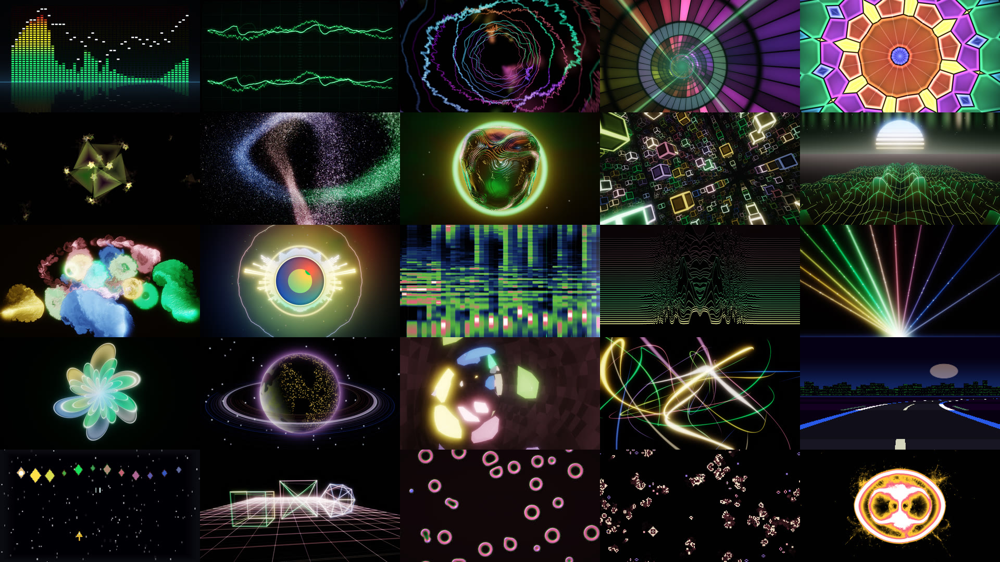
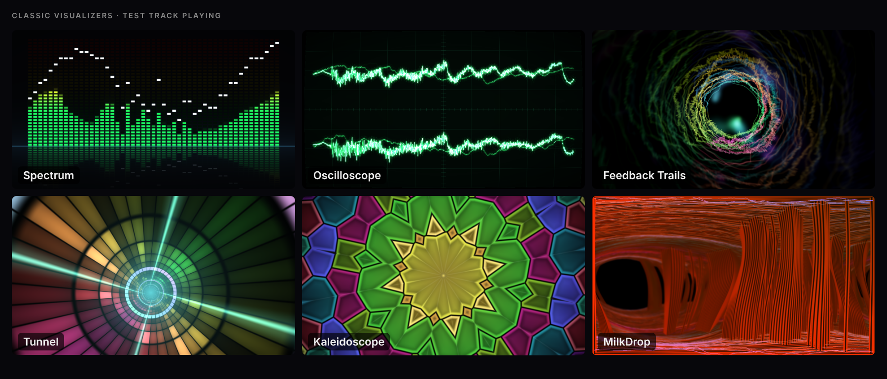
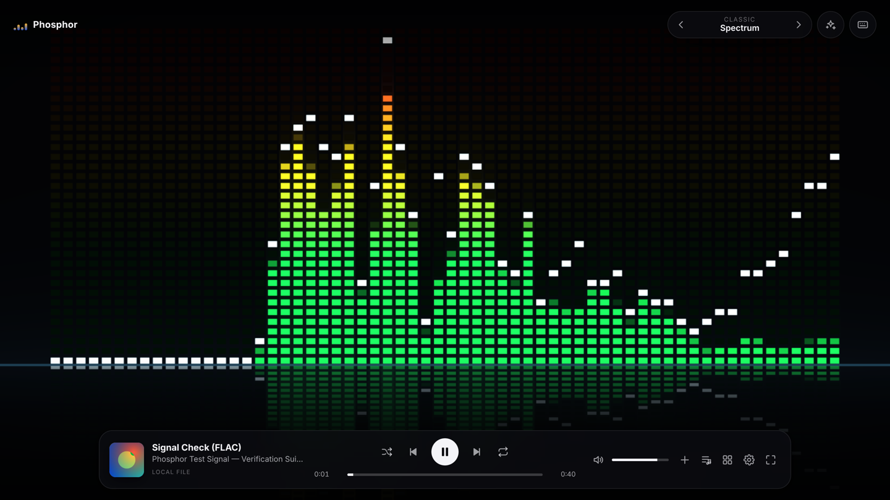

# Phosphor

A music player whose main attraction is its visualizers. Put music on, go fullscreen, and the interface fades away to leave audio-reactive visuals filling the screen, coloured by the current track's cover art.


It plays local files, whatever your computer is playing (system or tab audio), Spotify, Apple Music and YouTube / YouTube Music. It's built with Vite, TypeScript, WebGL2 and Web Audio, needs no backend, and runs in Chrome or Edge, as an app you can install (on a computer or a phone), or as a desktop app for macOS and Windows (and, from v3, an experimental Android app).

> **This branch only holds this page.** The app lives on the branches below. Pick one first.

## Which branch?

| Branch | What it is | Pick it if |
| --- | --- | --- |
| [**v1**](../../tree/v1) | The first complete version, kept as it was: 12 visualizers, local files, system audio capture, Spotify, Apple Music and YouTube. | You want the stable version. |
| [**v2**](../../tree/v2) | The new version: everything in v1, plus the fixes and features listed [below](#whats-new-in-v2): 25 visualizers, beat tracking, crossfades and DJ mixes, playlists across services, a phone-friendly installable app and a desktop app. | You want the newest features. It has had less time with the real streaming services than v1 (see its README). |
| [**v3**](../../tree/v3) | The newest version: everything in v2, plus what's listed [below](#whats-in-v3): 43 visualizers with a Games category, a presenter window for an audience screen, Spotify inside the desktop app, ProPresenter, FreeShow and OBS integration, streaming visuals without sharing the tab, and an experimental Android app. | You want the newest features. Parts of it have only been tested against simulations of the services and programs it talks to so far (see its README). |

To get the code, open the branch, click the green **Code** button and choose **Download ZIP**. Or, with git: `git clone --branch v1 <this repository's URL>` (use `v2` or `v3` for the newer versions).

## Quick start

You need [Node.js](https://nodejs.org) 20.19 or newer (or 22.12+) and Chrome or Edge. In the downloaded folder:

```bash
npm install
```

```bash
npm run dev
```

Then open **http://127.0.0.1:5173** in Chrome. Use `127.0.0.1`, not `localhost`, because Spotify's sign-in only accepts that address. Leave the terminal open while you use it; press Ctrl+C there to stop.

Then:

- **Your own music:** drag files or a folder onto the window, or click **Play demo** for a built-in track.
- **Anything playing on your computer:** press **C** and share a tab or your screen with audio. The app shows what to pick for your OS.
- **Fullscreen and visualizers:** press **F**; **←** / **→** change visualizer; **?** lists every shortcut.

Safari and Firefox can play local files but can't capture audio, and Spotify's player doesn't work in them. Use Chrome or Edge.

## Setting up Spotify, Apple Music and YouTube

The README on the branch you picked has step-by-step setup for each service. All three are optional; everything else works without them.

| Service | Needs |
| --- | --- |
| YouTube / YouTube Music | Nothing to paste links. A free API key adds search and popular music; an optional Google sign-in (v2) adds your own playlists and likes. |
| Spotify | A Spotify Premium account and a free app registered in Spotify's developer dashboard (about 5 minutes). |
| Apple Music | A paid Apple Developer membership (for the token) and an Apple Music subscription for full tracks. |

Streaming services don't let web pages read their audio, so the visualizers react once you share the tab's audio. The app asks for this with one click when it's needed.

## The visualizers

Version 2 has twenty-five, in five categories (classic, modern, 3D, retro and arcade, simulations):



Version 1's twelve:






## What's new in v2

All of it is on the [v2](../../tree/v2) branch; its README has the details.

1. **Fixes:** the next song starts by itself when a Spotify song ends; macOS Now Playing shows the track, artist and artwork, and media keys control Phosphor.
2. **Easier start:** streaming services on the first screen with their live state; starting a streaming song opens the share-audio dialog straight away.
3. **Library:** a home view for each service (recently played, top songs, your playlists and albums, Apple's For You and charts, YouTube's popular music and, with Google sign-in, your own playlists), Spotify-made playlists played by link, saving to your Spotify or Apple Music library, and Phosphor playlists that mix tracks and whole playlists from every source, updating live.
4. **Better music reaction:** beat tracking that follows the drums, not the vocals (tested against signals with known beats), with kicks, the bassline, vocals, hi-hats and drops each driving something different in every visualizer, plus thirteen new visualizers in five categories.
5. **Playback:** crossfades of up to 12 seconds between any two sources, and DJ-style mixes between local files (tempo matched without changing pitch, beats and bars lined up, keys taken into account).
6. **Apps:**
   - **Install it** from Chrome or Edge on a computer, Chrome on Android, or Safari on iPhone and iPad (Share, Add to Home Screen). It opens in its own window and works offline with your own files. Phones can't share other apps' audio with a page, so there it listens through the microphone.
   - **A desktop app for macOS and Windows,** with a live visualizer in the macOS menu bar or the Windows tray and a mini player under it. It listens to the whole computer without the share dialog, shows as Phosphor in Now Playing, and plays Spotify through the Spotify app. Download it from the repository's **Actions** tab: open the latest **Desktop app** run and get **Phosphor-macOS** (disk images for Apple silicon and Intel Macs) or **Phosphor-Windows** (an installer) under *Artifacts*. Those downloads are kept for 14 days; tagging a version (for example `v2.0.0`) makes a permanent release with the installers attached. They aren't signed with a paid certificate, so the first launch needs an extra click; the v2 README explains it.

## What's in v3

The [v3](../../tree/v3) branch, in the order it was planned:

1. **Presenter view:** **Present** opens a second window with only the visuals, for a projector, a TV or a stage screen, full screen on the display you choose, in step with the main window (0 ms behind in the tests). The main window stays the controller and switches overlays on the audience screen: a QR code for the song (its Spotify, Apple Music or YouTube page), the title and artist, a logo, blackout and freeze.
2. **Eighteen more visualizers (43 in all), with a Games category:** original scenes in the spirit of game genres (a lantern-lit cave kingdom, a voxel valley, a painterly meadow, bullet dodging, a rhythm runner, rocket cars and a ball), with no characters, names, art or music from any game, plus an XY scope, an aurora, a spiral galaxy, a turntable, a rainy window, ferrofluid, a black hole, a lava lamp, a circuit board, fireworks, a ripple pool and a murmuration. Each one's reaction to bass, mids, treble and beats is measured.
3. **Desktop platform:** compared with Tauri, Electron does more for Phosphor (Spotify's web player and video output need Chromium), so the desktop app stays on Electron, now castLabs' build with Widevine.
4. **Spotify inside the desktop app,** without the Spotify app: Spotify's own web player plays in it. Optionally (off by default, with a warning, since Spotify's terms don't allow it) it plays through the bundled librespot, whose sound the visualizers hear directly.
5. **No tab sharing in the browser:** set up a free loopback device once (BlackHole on a Mac, VB-CABLE or Stereo Mix on Windows, a monitor input on Linux) and Phosphor listens to it by itself whenever a streaming song plays, with no dialog. Tab sharing stays as the default.
6. **ProPresenter, FreeShow and OBS:** the desktop app sends the visuals as an NDI source (using the NDI Runtime from NDI's free NDI Tools) or a web page, behind lyrics or full screen, and follows their slides: commands in a slide's notes, FreeShow actions and Companion buttons through a control address, and a new song can trigger a ProPresenter macro or fill FreeShow variables. Syphon and Spout aren't offered; NDI does the same job in all three.
7. **Phones:** a native app turned out to be the only way to visualize Spotify on a phone without the microphone, so there's an experimental Android app (built and unit-tested by GitHub Actions, not yet tried on a real phone). iOS waits for a paid Apple developer account.

Download the desktop app or the Android app from the repository's **Actions** tab: the latest **Desktop app** run (Phosphor-macOS, Phosphor-Windows) or **Android app** run (Phosphor-Android), under *Artifacts*. The [v3 README](../../tree/v3#readme) has the details, setups and what still needs testing with real services.
