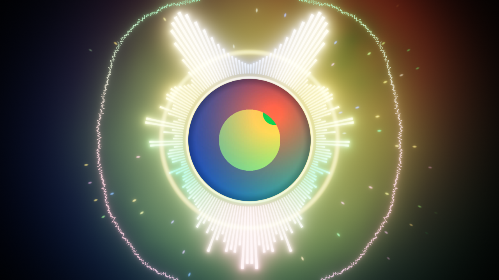
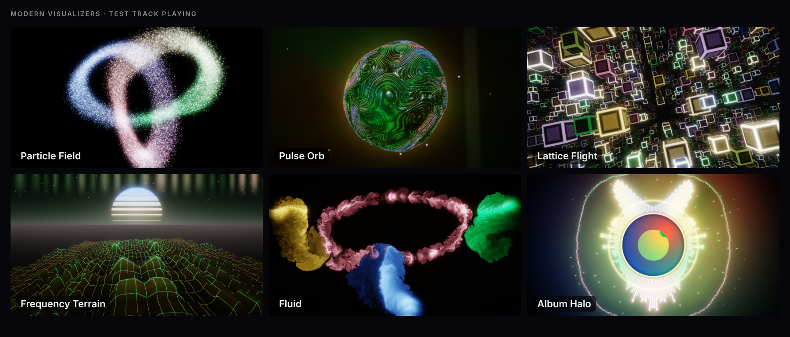

# Phosphor

A music player whose main attraction is its visualizers. Put music on, go fullscreen, and the interface fades away to leave audio-reactive visuals filling the screen, coloured by the current track's cover art.



It plays local files, whatever your computer is playing (system or tab audio), Spotify, Apple Music and YouTube / YouTube Music. It's built with Vite, TypeScript, WebGL2 and Web Audio, needs no backend, and runs in Chrome or Edge.

> **This branch only holds this page.** The app lives on the branches below. Pick one first.

## Which branch?

| Branch | What it is | Pick it if |
| --- | --- | --- |
| [**v1**](../../tree/v1) | The first complete version, kept as it was: 12 visualizers, local files, system audio capture, Spotify, Apple Music and YouTube. | You want the stable version. |
| [**v2**](../../tree/v2) | The next version, in progress. Everything in v1, plus the fixes and features listed [below](#whats-coming-in-v2) as they land. | You want the newest features and don't mind some being unfinished. |

To get the code, open the branch, click the green **Code** button and choose **Download ZIP**. Or, with git: `git clone --branch v1 <this repository's URL>` (use `v2` for the newer version).

## Quick start

You need [Node.js](https://nodejs.org) 20.19 or newer (or 22.12+) and Chrome or Edge. In the downloaded folder:

```bash
npm install
```

```bash
npm run dev
```

Then open **http://127.0.0.1:5173** in Chrome. Use `127.0.0.1`, not `localhost`, because Spotify's sign-in only accepts that address. Leave the terminal open while you use it; press Ctrl+C there to stop.

Then:

- **Your own music:** drag files or a folder onto the window, or click **Play demo** for a built-in track.
- **Anything playing on your computer:** press **C** and share a tab or your screen with audio. The app shows what to pick for your OS.
- **Fullscreen and visualizers:** press **F**; **←** / **→** change visualizer; **?** lists every shortcut.

Safari and Firefox can play local files but can't capture audio, and Spotify's player doesn't work in them. Use Chrome or Edge.

## Setting up Spotify, Apple Music and YouTube

The README on the branch you picked has step-by-step setup for each service. All three are optional; everything else works without them.

| Service | Needs |
| --- | --- |
| YouTube / YouTube Music | Nothing to paste links. A free API key adds search. |
| Spotify | A Spotify Premium account and a free app registered in Spotify's developer dashboard (about 5 minutes). |
| Apple Music | A paid Apple Developer membership (for the token) and an Apple Music subscription for full tracks. |

Streaming services don't let web pages read their audio, so the visualizers react once you share the tab's audio. The app asks for this with one click when it's needed.

## The visualizers





## What's coming in v2

Work happens on the [v2](../../tree/v2) branch, in this order:

1. **Fixes** (done): the next song starts by itself when a Spotify song ends; macOS Now Playing shows the track, artist and artwork, and media keys control Phosphor.
2. **Easier start:** streaming services on the first screen; less manual audio sharing.
3. **Library:** browsing each service, and Phosphor playlists that mix tracks and whole playlists from Spotify, Apple Music, YouTube and local files, updating live.
4. **Better music reaction:** beat tracking that follows the drums rather than vocals, with different parts of each visualizer reacting to different parts of the song, plus at least 12 new visualizers.
5. **Playback:** crossfade, and DJ-style "mix" transitions for local files.
6. **Apps:** desktop apps for macOS and Windows (with a menu-bar visualizer), and an installable phone version.
