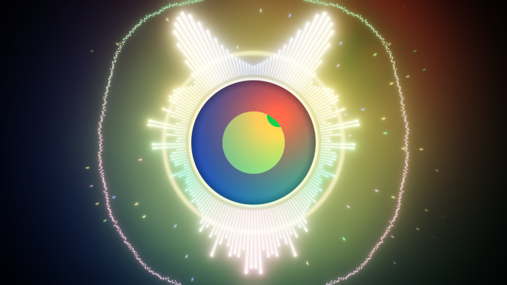
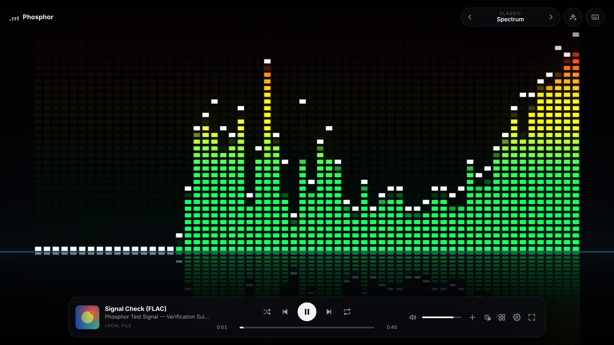
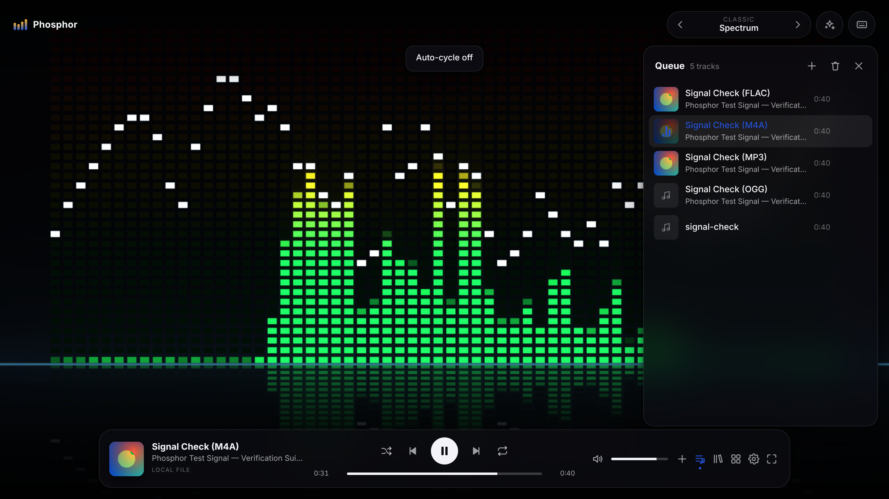
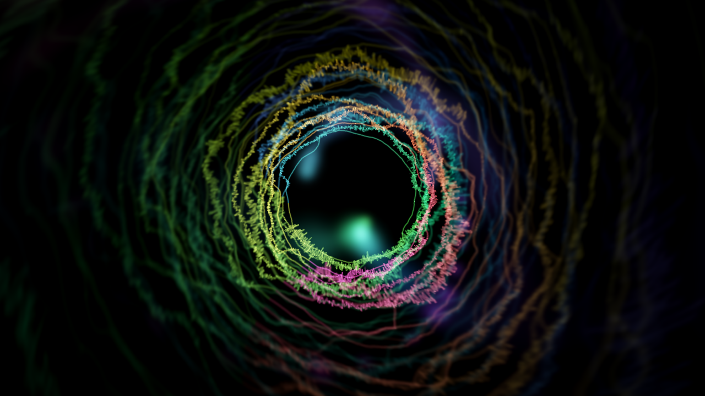
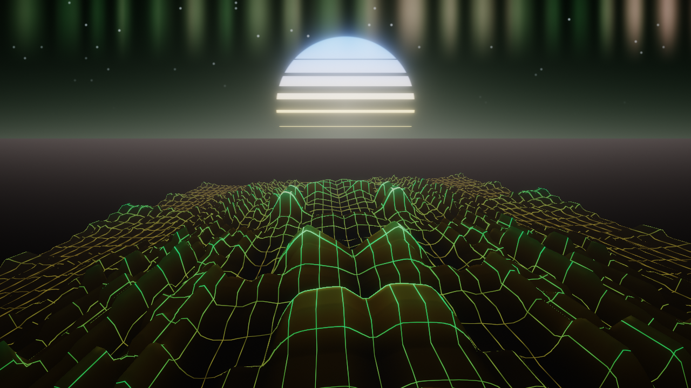

# Phosphor

A music player for the browser whose main attraction is its visualizers. Put music on, press <kbd>F</kbd>, and the interface fades away to leave twelve audio-reactive visualizers filling the screen.



- **Sources:** local files (MP3, FLAC, WAV, M4A/AAC, OGG/Opus and anything else Chrome or Edge decodes), whatever your computer is playing (system or tab audio capture), Spotify, Apple Music, and YouTube / YouTube Music.
- **Visualizers:** six classic (spectrum bars, oscilloscope, feedback trails, tunnel, kaleidoscope, real MilkDrop presets) and six modern (GPU particles, two raymarched scenes, a 3D frequency terrain, a fluid simulation, and a radial spectrum around the album art). Bass, mids, treble and beats each drive something different in every one of them.
- **Player:** queue, shuffle, repeat, seek, volume, keyboard shortcuts, media keys, drag and drop, folders, tags and cover art, a visualizer gallery, auto-cycling with crossfades.
- **Stack:** Vite + TypeScript, raw WebGL2, Web Audio. No backend and no framework. Runs in Chrome or Edge.

## Quick start

```bash
npm install
```

```bash
npm run dev
```

Then open **http://127.0.0.1:5173** (use `127.0.0.1`, not `localhost`: Spotify only accepts that form of local address for sign-in, and `localhost` redirects there anyway). Drop some audio files on the window, or click **Play demo** for a built-in synthesised track.

To build static files for hosting anywhere: `npm run build`, then serve `dist/`. If you host it somewhere other than `http://127.0.0.1:5173`, it must be served over **https** for Spotify sign-in, and the redirect URI in your Spotify app has to match the new address.

Local files, system audio capture and YouTube links work without any setup. Spotify and Apple Music need credentials from you; see [Streaming services](#streaming-services).

## Using it

<table>
<tr><td></td><td></td></tr>
<tr><td></td><td></td></tr>
</table>

| Key | Action |
| --- | --- |
| <kbd>Space</kbd> | Play / pause |
| <kbd>←</kbd> <kbd>→</kbd> | Previous / next visualizer |
| <kbd>Shift</kbd>+<kbd>←</kbd> <kbd>→</kbd> | Previous / next MilkDrop preset |
| <kbd>1</kbd>…<kbd>0</kbd> | Jump to a visualizer |
| <kbd>A</kbd> | Auto-cycle visualizers on / off |
| <kbd>G</kbd> | Visualizer gallery |
| <kbd>↑</kbd> <kbd>↓</kbd> | Volume |
| <kbd>M</kbd> | Mute |
| <kbd>N</kbd> / <kbd>P</kbd> | Next / previous track (previous restarts the track if you are more than 3 s in) |
| <kbd>J</kbd> / <kbd>L</kbd> | Seek back / forward 10 seconds |
| <kbd>S</kbd> / <kbd>R</kbd> | Shuffle / repeat (off, all, one) |
| <kbd>Q</kbd> | Queue (click to play, drag to reorder) |
| <kbd>O</kbd> | Add music |
| <kbd>C</kbd> | Capture system or tab audio |
| <kbd>F</kbd> | Fullscreen (or double-click the visuals) |
| <kbd>,</kbd> / <kbd>?</kbd> | Settings / list of shortcuts |
| <kbd>Esc</kbd> | Close whatever is open |

Media keys, headset buttons and the OS "now playing" widget control playback too.

In fullscreen the controls fade out a few seconds after the mouse stops (Settings can make that happen always, or never). They stay while the pointer is over them. Auto-cycle picks a new visualizer every 15 seconds to 5 minutes, shuffled or in order, crossfading between them; it pauses while nothing is playing. Quality defaults to **Auto**, which lowers the internal render resolution when frames start dropping and raises it again when there is headroom, so the frame rate holds on slower GPUs.

Settings, the last visualizer, volume, shuffle and repeat are remembered in the browser.

## Visualizers

| | Visualizer | Bass | Mids | Treble | Beats |
| --- | --- | --- | --- | --- | --- |
| 1 | **Spectrum** – LED bars with gravity-driven peak caps and a floor reflection | left-hand bars, floor glow | middle bars | right-hand bars | bars and floor flare |
| 2 | **Oscilloscope** – left and right waveforms as a beam on a phosphor tube | beam thickens | waveform shape | beam brightens on hits | beam and graticule flash |
| 3 | **Feedback Trails** – waveform rings leave swirling, colour-cycling trails | outward zoom | swirl strength and spin | hue rotation speed, comets | zoom kick; every 8 beats the swirl reverses |
| 4 | **Tunnel** – tiled demoscene tunnel; past sound flies toward you as lit tiles | glow at the far end | bend and roll | neon tubes fizz | walls lurch, steel ribs flash |
| 5 | **Kaleidoscope** – mirrored stained glass, each shard tied to one frequency | zoom | spin and tumble | bevel glints, sparkles | flash; every 16 beats the mirror count changes |
| 6 | **MilkDrop** – genuine MilkDrop presets via butterchurn, a curated set of 24 | per preset | per preset | per preset | preset changes on a beat every ~30 s |
| 7 | **Particle Field** – ~190,000 GPU particles forming shapes | shape swells | flow-field turbulence, orbit speed | glitter flashes | explosion outward; every 16 beats a new shape |
| 8 | **Pulse Orb** – raymarched liquid-metal sphere | swell and wobble | regions of skin bulge with their band | skin roughens, sparks | shockwave ring |
| 9 | **Lattice Flight** – raymarched flight through a grid of cubes, one band each | flight speed | roll | edges spark | light wave races down the corridor |
| 0 | **Frequency Terrain** – a landscape built from the last few seconds of spectrum | height, sun size, horizon glow | ridges | aurora, wire shimmer, stars | sun pulse, grid flash |
| | **Fluid** – Navier–Stokes ink simulation | fountain from the bottom | jets from the sides | circling nozzles, finer swirls | ink bursts |
| | **Album Halo** – cover art ringed by a radial spectrum and waveform halo | disc swells, rim light | spectrum bars | sparks | ripples leave the disc |

The modern family (and Album Halo's disc) take their colours from the current track's artwork; the interface accent colour follows it too. With no artwork, Album Halo shows a spinning record instead.

<table>
<tr><td></td><td></td><td></td></tr>
<tr><td></td><td></td><td></td></tr>
<tr><td></td><td></td><td></td></tr>
<tr><td></td><td></td><td></td></tr>
</table>

### Adding a visualizer

Add one file to `src/viz/visualizers/`. It is registered automatically and appears in the gallery, the arrow-key rotation and auto-cycle.

```ts
import { COMMON_UNIFORMS, FS_HEADER } from '../../gl/glsl';
import { drawFullscreen, FULLSCREEN_VS, Program } from '../../gl/util';
import { bindOutput, commonUniforms, defineVisualizer } from '../types';

const FS = /* glsl */ `${FS_HEADER}
in vec2 vUv; out vec4 o;
${COMMON_UNIFORMS}
void main() {
  float s = texture(uSpectrum, vec2(vUv.x, 0.5)).r;              // log-spaced spectrum, 0..1
  float bar = step(vUv.y, s);
  o = vec4(mix(uPal[0], uPal[1], vUv.y) * bar * (0.6 + uBeat) + uBass * 0.1, 1.0);
}`;

export default defineVisualizer({
  id: 'hello',
  name: 'Hello Bars',
  family: 'classic',
  order: 200,
  description: 'The smallest possible example.',
  create({ gl }) {
    const program = new Program(gl, FULLSCREEN_VS, FS);
    return {
      resize() {},
      render(frame) {
        bindOutput(gl, frame);
        program.use().set(commonUniforms(frame));
        drawFullscreen(gl);
      },
      dispose() {
        program.dispose();
      },
    };
  },
});
```

Every visualizer receives the same analysis each frame (`frame.audio` in TypeScript, uniforms and textures in GLSL):

- `spectrum`: 128 log-spaced bands from 32 Hz to 16 kHz, 0..1, auto-gained with a treble tilt so quiet captures and loud masters both fill the range; also uploaded as the `uSpectrum` texture, plus a 256-row scrolling history texture (`uHistory`).
- `waveform`, `waveL`, `waveR`: 1024 trigger-aligned samples, gain-normalised (`uWave`).
- `bass`, `mid`, `treble`, `level`: smoothed band energies; `bassHit`, `midHit`, `trebleHit`: transient emphasis.
- `beat` (true on the beat frame), `beatPulse` (1 decaying to 0), `beatCount`: adaptive spectral-flux beat detection gated on low-frequency energy.
- `palette`: four colours from the current artwork (`uPal`), and the artwork itself (`uArtwork`).

`src/gl` has the small WebGL2 toolkit the built-in ones use (programs with named uniforms, render targets, ping-pong buffers, bloom).

## System audio

This is the universal source: anything playing on your computer, or in another tab, can drive the visualizers. Open **Add music → System audio** (or press <kbd>C</kbd>) and the browser's share dialog appears. The captured sound is only analysed and never played back, so you won't hear it twice. Only the audio track is kept; the picture is discarded at once.

What the share dialog can capture depends on your OS (the app shows the right advice for yours):

| | One browser tab | Everything the computer plays |
| --- | --- | --- |
| **Windows** | Choose the tab, switch on *Also share tab audio* | Choose *Entire screen*, switch on *Also share system audio* |
| **macOS** | Choose the tab, switch on *Also share tab audio* | *Entire screen* + *Also share system audio*, on macOS 14.2 or later with a recent Chrome or Edge (about version 141 on). On older versions use a loopback driver such as BlackHole with **Audio input device**. |
| **Linux** | Choose the tab, switch on *Also share tab audio* | Not offered by Chrome. Use **Audio input device** and pick your sound server's "Monitor of …" source. |
| **ChromeOS** | As Windows | As Windows |

Sharing a single *window* never includes sound. **Audio input device** listens to any input (a loopback device, a monitor source, a mixer, or a microphone near the speakers) as an alternative.

## Streaming services

Spotify, Apple Music and YouTube all play through their **official** web players. None of them lets a web page read the audio: Spotify and Apple Music stream it with DRM, and YouTube plays inside its own cross-origin iframe. So the design is:

1. The service's own player handles sign-in, playback, track info and artwork, driven by Phosphor's queue and controls.
2. The visualizers listen to **this tab's audio**, shared once per session through the same capture as above. When a streaming track is playing and nothing is shared yet, a banner offers **Share this tab's audio**; in the dialog, pick the Phosphor tab itself (Chrome offers it first) with tab audio switched on.

Because the audio is captured after the service has applied its volume, turning Phosphor's volume very low also gives the visuals less to work with, and muting silences them. To listen quietly, turn your system volume down instead. Local files don't have this limitation.

All three go in one shared queue alongside local files, with the same shortcuts and media keys. Credentials are pasted into **Settings** and stored only in this browser's localStorage; they are sent nowhere except to the service they belong to.

### Spotify

Needs: a **Spotify Premium** account (Spotify does not allow browser playback for free accounts, and since February 2026 the app owner must have Premium for a development-mode app to work at all).

1. Go to the [Spotify developer dashboard](https://developer.spotify.com/dashboard), sign in, and click **Create app**.
2. Give it any name and description. Under **Redirect URIs** add exactly `http://127.0.0.1:5173/` (the trailing slash matters; `localhost` is rejected by Spotify). After saving, check the dashboard didn't rewrite it.
3. Under *Which API/SDKs are you planning to use?* tick **Web API** and **Web Playback SDK**. Save.
4. Open the app's **Settings** and copy the **Client ID**. You don't need the client secret: Phosphor uses the PKCE flow, which is designed for apps without a backend.
5. In Phosphor: **Settings → Spotify → Client ID**, paste it. Then **Add music → Spotify → Connect Spotify** and approve in the popup.
6. Optional: to let other people use your copy, add them under **User Management** in the dashboard (development mode allows five).

Then search, open your playlists and Liked Songs, or paste `open.spotify.com` / `spotify:` links for tracks, albums and playlists.

Limits: search returns at most 10 results per type (Spotify's cap for development-mode apps). Sign-in lasts until you disconnect; tokens refresh automatically.

### Apple Music

Needs: a paid **Apple Developer Program** membership (to create a MusicKit key), and an **Apple Music subscription** for full tracks (without one, Apple plays 30-second previews).

1. In [Certificates, Identifiers & Profiles](https://developer.apple.com/account/resources/identifiers/list), click **+**, choose **Media IDs**, give it a description (people see this when signing in) and a reverse-domain identifier such as `media.com.yourname.phosphor`, tick **MusicKit**, and register it.
2. Go to **Keys**, click **+**, name the key, tick **Media Services (MusicKit, ShazamKit)**, click **Configure** and pick the Media ID from step 1. Continue and register.
3. **Download** the `AuthKey_XXXXXXXXXX.p8` file (Apple only lets you download it once) and note the **Key ID**. Your **Team ID** is under *Membership details* on your account page. Keep the `.p8` file private; it is git-ignored here.
4. Generate a developer token (valid up to six months):

   ```bash
   npm run apple-token -- --team-id ABCDE12345 --key-id 1A2B3C4D5E --key ./AuthKey_1A2B3C4D5E.p8
   ```

   Add `--origin http://127.0.0.1:5173` to lock the token to your copy of the app.
5. In Phosphor: **Settings → Apple Music**, paste the token. Then **Add music → Apple Music → Connect Apple Music** and sign in with your Apple ID in Apple's window.

Then search the catalog, open your library playlists, or paste `music.apple.com` song, album and playlist links. When the token expires, generate a new one and reload the page. If sign-in fails with an authorization error, check that the Team ID and Key ID match the key you downloaded.

### YouTube and YouTube Music

Needs: nothing for links. Paste any `youtube.com`, `youtu.be`, `shorts` or `music.youtube.com` video or playlist link in **Add music → YouTube**. For a YouTube Music album, use **Share** on the album page: it gives a playlist link, which works.

Optional, for search and named playlist tracks: a **YouTube Data API key**.

1. In the [Google Cloud console](https://console.cloud.google.com/), create a project.
2. **APIs & Services → Library**, find **YouTube Data API v3**, and **Enable** it.
3. **APIs & Services → Credentials → Create credentials → API key**.
4. Edit the key: under *API restrictions* choose **Restrict key → YouTube Data API v3**; under *Application restrictions* choose **Websites** and add `http://127.0.0.1:5173/*` (and your hosted address, if any).
5. In Phosphor: **Settings → YouTube → Data API key**, paste it.

Limits:

- There is no sign-in. YouTube has no official API for a YouTube Music library, likes or history, so those can't be browsed; public and unlisted playlists work by link.
- Each search costs about 200 of the key's 10,000 free daily quota units, so roughly 50 searches a day. Playing links costs at most a few units.
- Some videos (often official label music videos) are blocked by their owners from playing outside YouTube. They are skipped with a message.
- YouTube's terms require the player to remain visible while it plays, so a small video frame stays in the bottom-left corner, even in fullscreen.

## How it was tested

`scripts/verify.cjs` drives a real Chromium with real audio playing, using a test track synthesised by `scripts/make-test-audio.mjs` (the same original composition the app ships as its demo) and encoded to MP3, FLAC, OGG, WAV and M4A with tags and cover art.

```bash
npm run test-audio
```

```bash
npm run dev
```

```bash
xvfb-run -a npm run verify
```

(`xvfb-run` is only needed on a machine without a display. The script needs [Playwright](https://playwright.dev) with Chromium and ffmpeg on the PATH.)

It checks:

- **Visualizers:** each one renders and animates with the track playing, and gets a screenshot (`docs/screenshots`, also used for the gallery thumbnails).
- **Reaction:** deterministic A/B renders of every visualizer, with silence versus an isolated kick drum, a midrange chord and a hi-hat, and with beat detection withheld versus not. Each must change its image for bass, mids, treble and beats separately. The analysis layer is checked first, to show each stimulus lands only in its own band.
- **Player and interface:** tags and art from each format, decoding each format, every keyboard shortcut, crossfades, the gallery, auto-cycle, queue editing, drag and drop, folders with cover images, an undecodable file, the idle fade, fullscreen, the demo track, settings persistence.
- **Capture:** real `getDisplayMedia` capture of another tab and of the app's own tab, including that the captured audio has no path to the speakers.
- **Spotify, Apple Music, YouTube:** each against a local simulation of the service (in `scripts/mocks`) that follows the documented behaviour: OAuth with real PKCE verification, the Web API's 2026 response shapes, the playback SDK's events, MusicKit's queue and events, the IFrame API's states and errors, the Data API with quotas and pagination. These prove Phosphor's side of each integration. They cannot prove the real services behave as documented; see below.

## Status

**Working and verified in a real browser with audio:** local files (all formats listed, tags, embedded and folder cover art, drag and drop, folders), the queue and every control and shortcut, media keys, fullscreen with idle fade, all twelve visualizers with crossfades, gallery and auto-cycle, system and tab audio capture.

**Needs your credentials before it can be tested against the real service:**

- Spotify (Client ID + Premium)
- Apple Music (developer token from a paid developer account + subscription)
- YouTube links work without anything, but could not be tried against real YouTube from the build environment; search additionally needs an API key.

**Not verifiable here, and worth knowing:**

- The build environment had no network access to Spotify, Apple or YouTube and no GPU (rendering used a software rasteriser), so the integrations were tested against simulations, and frame rates here say nothing about real hardware. I expect a typical laptop GPU to hold 60 fps at 1080p, but I could not measure that. The heaviest visualizers are the raymarched Pulse Orb and Lattice Flight and the Particle Field; Auto quality lowers the internal resolution when frames drop (verified to work, under software rendering), and **Settings → Quality → Low** goes further. Turn on **Settings → Show frame rate** to see what yours does.
- Whole-system audio on macOS depends on your macOS and Chrome versions (see the table above); tab audio works everywhere.
- M4A/AAC playback relies on Chrome's or Edge's AAC decoder (plain Chromium builds lack it).
